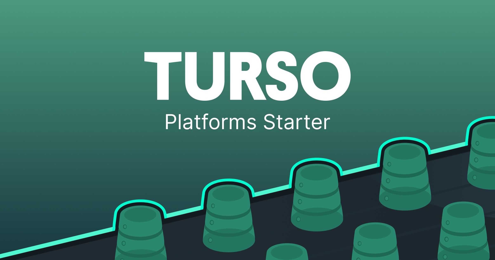

# SQLite Per User Starter

A Next.js application that gives every user their own SQLite database. Databases can be created on [Turso](https://turso.tech) or [Bunny Database](https://bunny.net/database), and sign-in can use [Clerk](https://clerk.com) or [Better Auth](https://www.better-auth.com).



## Demo

The app below uses a database per user, and is powered by Turso.

[https://turso-per-user-starter.vercel.app](https://turso-per-user-starter.vercel.app)

## Get Started

Deploy your own Turso powered platform in a few easy steps...

- [Create the control database](https://sqlite.new?dump=https%3A%2F%2Fraw.githubusercontent.com%2Fnotrab%2Fturso-per-user-starter%2Fmain%2Fdump.sql)

  - This database records which database belongs to which user. Each user's own database is created automatically when they sign up.
  - Once the database is created, you'll be presented with details about your database, and **Connect** details
  - Note down the following (you'll need these later):
    - Database URL
    - Org name
    - Group Token (**Create Group Token** -> **Create Token**)
    - Platform API Token (**Create Platform API Token** -> **Insert memorable name** -> **Create Token**))

- [Sign up to Clerk](https://clerk.com)
  - Create a new application from the dashboard
  - Note down the following (you'll need these later):
    - Public key
    - Secret key
- [Deploy with Vercel](https://vercel.com/new/clone?repository-url=https%3A%2F%2Fgithub.com%2Fnotrab%2Fturso-per-user-starter&env=NEXT_PUBLIC_CLERK_PUBLISHABLE_KEY,CLERK_SECRET_KEY,CONTROL_DATABASE_URL,CONTROL_DATABASE_AUTH_TOKEN,TURSO_API_TOKEN,TURSO_ORG,TURSO_GROUP_AUTH_TOKEN&demo-title=Turso%20Per%20User%20Starter&demo-description=Create%20a%20database%20per%20user&demo-image=https://raw.githubusercontent.com/notrab/turso-per-user-starter/28373b4c9c74f814e3749525ee3d53b603176834/app/opengraph-image.png&demo-url=https%3A%2F%2Fturso-per-user-starter.vercel.app)
  - Add the following environment variables (from the details you noted down earlier):
    - `NEXT_PUBLIC_CLERK_PUBLISHABLE_KEY` - Clerk public key
    - `CLERK_SECRET_KEY` - Clerk secret key
    - `CONTROL_DATABASE_URL` - Control database URL
    - `CONTROL_DATABASE_AUTH_TOKEN` - Group Token (the control database is in the same group)
    - `TURSO_API_TOKEN` - Platform API Token
    - `TURSO_ORG` - Org name
    - `TURSO_GROUP_AUTH_TOKEN` - Group Token
  - Click **Deploy** and you're done!

_You may optionally set up webhooks to automate the creation of databases in the background &mdash; [learn more](https://github.com/notrab/turso-per-user-starter/wiki/Webhooks#using-webhooks-in-production)._

## Local Development

Start building your Turso powered platform in a few simple steps...

1. <details>
   <summary>Clone this repository</summary>

   Begin by cloning this repository to your machine:

   ```bash
   git clone https://github.com/notrab/turso-per-user-starter.git
   cd turso-per-user-starter
   ```

   </details>

2. <details>
   <summary>Install dependencies and initialize <code>.env</code></summary>

   Run the following:

   ```bash
   cp .env.example .env
   npm install
   ```

   </details>

3. <details>
   <summary>Create the control database</summary>

   The control database records which database belongs to which user. Follow the instructions to install the [Turso CLI](https://docs.turso.tech/cli/installation), and then run the following:

   ```bash
   turso db create control
   turso db show control --url
   ```

   Now update `.env` with your organization and the control database URL:

   ```bash
   TURSO_ORG=
   CONTROL_DATABASE_URL=
   ```

   > The `TURSO_ORG` can be your personal username, or the name of any organization you have with other users.

   > Working offline? Set `CONTROL_DATABASE_URL=file:control.db` and `DB_PROVIDER=local` to keep everything in local SQLite files instead.

   </details>

4. <details>
   <summary>Create a new group token</summary>

   Run the following:

   ```bash
   turso group tokens create default
   ```

   Now update `.env` to include the group token. The control database is in the same group, so it uses the same token:

   ```bash
   TURSO_GROUP_AUTH_TOKEN=
   CONTROL_DATABASE_AUTH_TOKEN=
   ```

   > If you didn't already have one, a new group will be created for you with the name `default`. To use another group, set `TURSO_GROUP`.

   </details>

5. <details>
   <summary>Run database migrations</summary>

   Set up the control database:

   ```bash
   npm run db:control:migrate
   ```

   Each user's database is migrated automatically when it's created. If you change `db/tenant/schema.ts`, generate a migration and apply it to every existing user's database:

   ```bash
   npm run db:tenant:generate
   npm run db:tenant:migrate
   ```

   </details>

6. <details>
   <summary>Create a new Turso API Token</summary>

   Run the following:

   ```bash
   turso auth api-tokens mint clerk
   ```

   Then set the API token in the `.env` file:

   ```bash
   TURSO_API_TOKEN=
   ```

  </details>

7. <details>
   <summary>Configure Clerk</summary>

   [Sign up to Clerk](https://clerk.com) and create a new application.

   Add your Clerk public key and secret key to the `.env` file:

   ```bash
   NEXT_PUBLIC_CLERK_PUBLISHABLE_KEY=
   CLERK_SECRET_KEY=
   ```

   </details>

8. <details>
   <summary>Run the application</summary>

   Run the following:

   ```bash
   npm run dev
   ```

   Now open [http://localhost:3000](http://localhost:3000) with your browser to try out the app!

    </details>

## Using Better Auth

Instead of Clerk, you can run your own auth with [Better Auth](https://www.better-auth.com). Users and sessions are stored in the control database, next to the record of each user's database, so there's no extra service to sign up for.

1. Set the following in `.env`:

   ```bash
   AUTH_PROVIDER=better-auth
   BETTER_AUTH_SECRET= # openssl rand -base64 32
   BETTER_AUTH_URL=http://localhost:3000
   ```

   The Clerk variables aren't needed.

2. Run `npm run db:control:migrate` if you haven't already. It creates the Better Auth tables.

Users sign up with an email and password. To add **Continue with GitHub**, create a [GitHub OAuth app](https://github.com/settings/developers) with the callback URL `<BETTER_AUTH_URL>/api/auth/callback/github`, then set `GITHUB_CLIENT_ID` and `GITHUB_CLIENT_SECRET`.

Each user's database is created when they sign up. If that fails, it's retried on their next visit.

The Better Auth setup lives in `lib/auth/providers/better-auth/`. Add plugins (email verification, passkeys, organizations and so on) in `auth.ts`. If a plugin needs extra columns, add them to `db/control/auth-schema.ts` and run `npm run db:control:generate`.

## Using Bunny Database

Each user's database can be created on [Bunny Database](https://bunny.net/database) instead of Turso. Both run libSQL, so the app code is the same.

1. Create the control database and a token for it with the [bunny CLI](https://bunny.net/docs/cli):

   ```bash
   bunny db create --name control --primary DE --token
   ```

   Set `CONTROL_DATABASE_URL` and `CONTROL_DATABASE_AUTH_TOKEN` from the output, then run `npm run db:control:migrate`.

2. Set the following in `.env`:

   ```bash
   DB_PROVIDER=bunny
   BUNNYNET_API_KEY=
   BUNNY_DB_STORAGE_REGION=eu-west-1
   BUNNY_DB_PRIMARY_REGIONS=DE
   TENANT_TOKEN_ENCRYPTION_KEY= # openssl rand -base64 32
   ```

   The `TURSO_*` variables aren't needed for a new deployment.

Things to know:

- Bunny issues a token per database. Tokens are stored encrypted in the control database with `TENANT_TOKEN_ENCRYPTION_KEY`, so keep that key safe and don't change it, or stored tokens can't be read.
- During the Public Preview an account can have 50 databases, of up to 1 GB each. One database per user means you'll reach that quickly, so ask [bunny.net support](https://support.bunny.net) to raise it before launching. Signups past the limit fail with a message saying so.
- Bunny has no export endpoint, so **Download my data** builds the SQL dump over a normal database connection.
- Users who already have a database stay on the provider they were created with. Changing `DB_PROVIDER` only affects new users. If you're moving an existing Turso deployment, keep the `TURSO_*` variables set so existing users' databases are still found and used.

## Optional: Webhook setup

You can automate the creation of databases per user in the background with webhooks.

[Read the wiki](https://github.com/notrab/turso-per-user-starter/wiki/Webhooks#using-webhooks-locally) for more information on how to set up webhooks with Clerk during development, and production.

## Tech Stack

- [Turso](https://turso.tech) for multi-tenant databases
- [Next.js](https://nextjs.org) for powerful full stack apps
- [Tailwind CSS](https://tailwindcss.com) for utility-first CSS
- [Drizzle](https://orm.drizzle.team) for database migrations and ORM
- [Clerk](https://clerk.com) for authentication
- [Vercel](https://vercel.com) for hosting

## Need help?

1. Open an issue on GitHub
2. Submit a Pull Request to improve this repo
3. [Join us on Discord](https://tur.so/discord)
